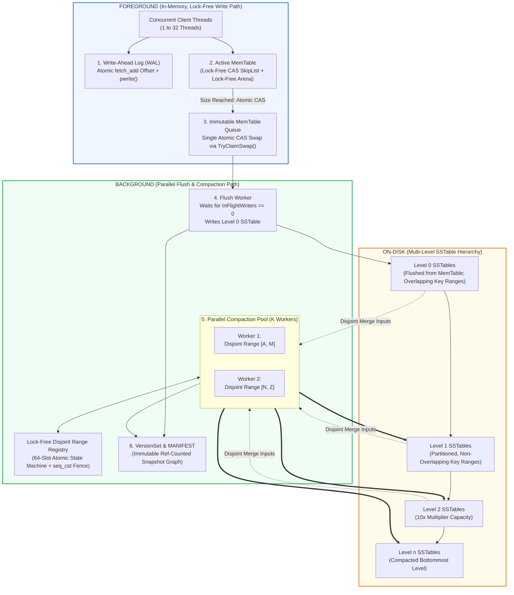
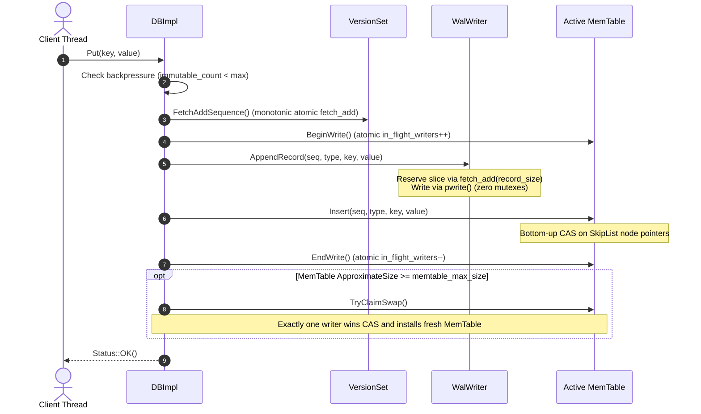
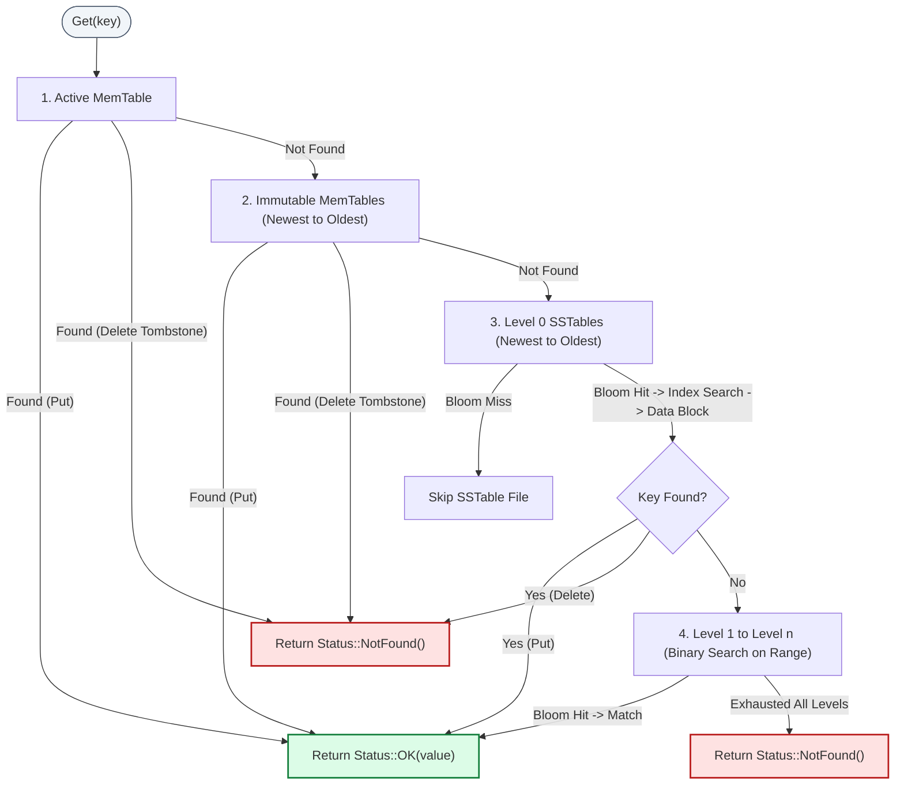
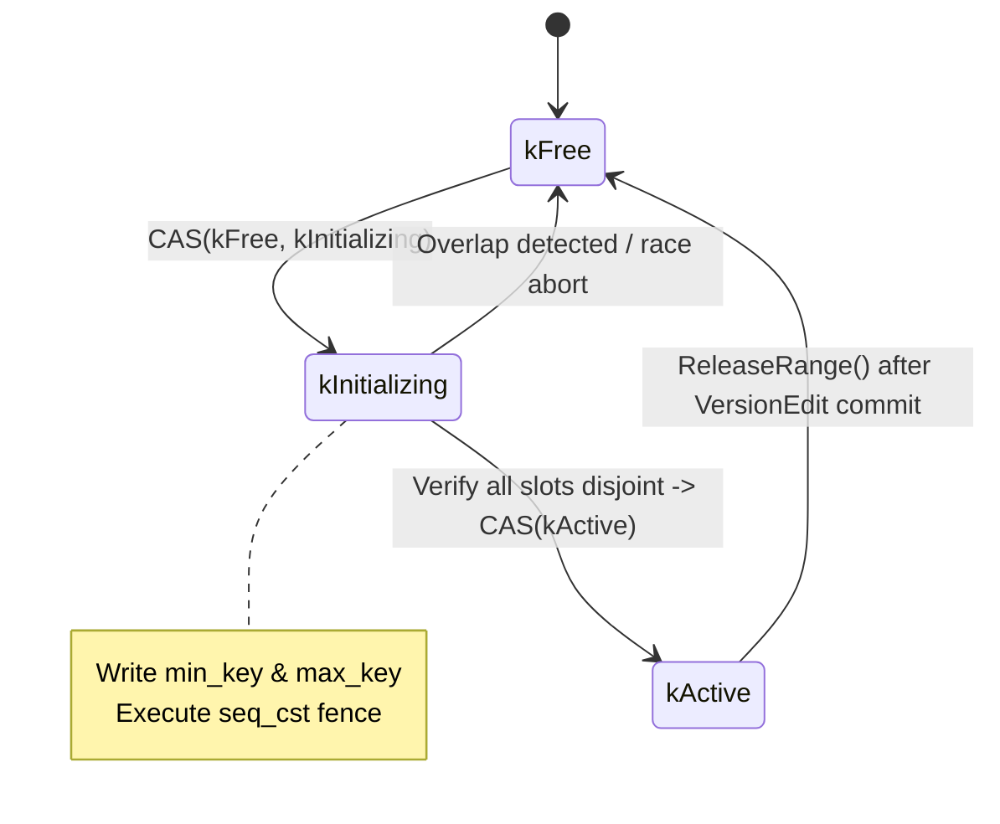

# Lock-Free LSM-Tree Storage Engine (C++17)

[](https://en.cppreference.com/w/cpp/17)
[]()
[](https://cmake.org/)
[](https://github.com/google/googletest)
[]()
[]()
[](LICENSE)

A high-performance, concurrent **Log-Structured Merge-Tree (LSM-Tree)** key-value storage engine implemented in modern **C++17**. The engine features a strictly lock-free write path, multi-version concurrency control (MVCC) with immutable snapshot isolation, parallel disjoint background compactions, Write-Ahead Logging (WAL) with group commit, and full crash recovery with zero lost acknowledged writes under `SIGKILL`.

---

## Table of Contents

- [1. Executive Overview & Purpose](#1-executive-overview--purpose)
  - [Key Technical Capabilities](#key-technical-capabilities)
  - [Why Lock-Free LSM-Tree?](#why-lock-free-lsm-tree)
- [2. System Architecture](#2-system-architecture)
  - [Architectural Block Diagram](#architectural-block-diagram)
  - [Foreground Path (Lock-Free Write Pipeline)](#foreground-path-lock-free-write-pipeline)
  - [Background Path (Parallel Flush & Compaction)](#background-path-parallel-flush--compaction)
  - [Read Path (Multi-Tier Hierarchical Lookup)](#read-path-multi-tier-hierarchical-lookup)
- [3. Technology Stack & Dependencies](#3-technology-stack--dependencies)
- [4. Repository Structure & Component Map](#4-repository-structure--component-map)
- [5. Core Algorithms & Concurrency Design](#5-core-algorithms--concurrency-design)
  - [Internal Key Encoding](#internal-key-encoding)
  - [Lock-Free CAS SkipList & Memory Arena](#lock-free-cas-skiplist--memory-arena)
  - [Lock-Free Write-Ahead Log (WAL)](#lock-free-write-ahead-log-wal)
  - [Lock-Free Disjoint Compaction Range Registry](#lock-free-disjoint-compaction-range-registry)
  - [On-Disk SSTable Layout & Bloom Filters](#on-disk-sstable-layout--bloom-filters)
  - [Multi-Version Manifest Protocol](#multi-version-manifest-protocol)
- [6. Installation & Prerequisites](#6-installation--prerequisites)
- [7. Build Instructions](#7-build-instructions)
  - [Standard Release Build](#standard-release-build)
  - [Sanitizer Builds (ASan / UBSan / TSan)](#sanitizer-builds-asan--ubsan--tsan)
  - [Helgrind Build](#helgrind-build)
- [8. Usage & Practical Examples](#8-usage--practical-examples)
  - [Interactive Command-Line Interface (`lsm_cli`)](#interactive-command-line-interface-lsm_cli)
  - [C++ Embedding API](#c-embedding-api)
- [9. Configuration & Options Reference](#9-configuration--options-reference)
- [10. Empirical Benchmarks & Performance Evaluation](#10-empirical-benchmarks--performance-evaluation)
  - [Workload Setup & Parameters](#workload-setup--parameters)
  - [Zipfian Skew Reproduction (Slide 3)](#zipfian-skew-reproduction-slide-3)
  - [Uniform Workload Throughput & P99 Latency](#uniform-workload-throughput--p99-latency)
  - [Zipfian Skew Throughput & P99 Latency](#zipfian-skew-throughput--p99-latency)
  - [Scientific Evaluation of Core Hypotheses](#scientific-evaluation-of-core-hypotheses)
  - [Compaction Overhead & Read Amplification](#compaction-overhead--read-amplification)
- [11. Test Suite & Verification Harness](#11-test-suite--verification-harness)
  - [Automated Test Suite Overview](#automated-test-suite-overview)
  - [Running Unit & Stress Tests](#running-unit--stress-tests)
  - [Crash Recovery Test Harness (SIGKILL)](#crash-recovery-test-harness-sigkill)
  - [Static Lock-Free Verification](#static-lock-free-verification)
- [12. Limitations, Troubleshooting & Future Roadmap](#12-limitations-troubleshooting--future-roadmap)
  - [Current Limitations](#current-limitations)
  - [Troubleshooting Common Issues](#troubleshooting-common-issues)
  - [Future Improvements](#future-improvements)
- [13. Author & License](#13-author--license)

---

## 1. Executive Overview & Purpose

Modern distributed data platforms encounter severe concurrency bottlenecks when high-velocity ingest paths compete on coarse-grained synchronization primitives (e.g., global table mutexes or partitioned shard locks). Under skewed access distributions (such as Zipfian or 80/20 hotspots), lock-based storage engines suffer from catastrophic thread convoying, cache-line bouncing, and tail-latency explosions.

This project delivers a **production-grade, lock-free LSM-Tree storage engine** designed to eliminate synchronization overhead across all performance-critical paths:

1. **Foreground Ingestion**: Replaces mutex contention with atomic atomic fetch-add sequence numbering, atomic WAL file-offset reservations (`pwrite`), and lock-free Compare-And-Swap (CAS) skip lists.
2. **MemTable Rotation**: Implements non-blocking active-to-immutable MemTable hand-off (`TryClaimSwap()`). Foreground writers never block waiting for background disk I/O; backpressure is mediated via bounded immutable queues.
3. **Parallel Compaction**: Features a lock-free Disjoint Range Registry with formal sequential-consistency (`seq_cst`) mutual exclusion, enabling multiple compaction workers to merge non-overlapping key ranges concurrently across levels.
4. **Resilient Durability**: Guarantees zero loss of acknowledged writes under process crashes or kernel `SIGKILL` signals through durable append-only WAL records protected by masked CRC32C checksums and torn-tail detection.

### Key Technical Capabilities

| Dimension | Implementation Details | Concurrency Guarantee |
|---|---|---|
| **Active MemTable** | Lock-Free CAS SkipList (`kMaxHeight = 12`, $p = 1/4$) | Lock-Free (zero mutexes on read/write) |
| **Memory Allocation** | Lock-Free Arena with atomic Treiber stack block reclamation | Lock-Free concurrent allocation |
| **Durability (WAL)** | Atomic `log_offset_.fetch_add()` + POSIX `pwrite()` | Mutex-free parallel appends |
| **Sync Policies** | `NO_SYNC`, `SYNC_EVERY_WRITE`, `GROUP_COMMIT` (CAS elected sync leader) | Configurable latency vs. durability |
| **Compaction** | Parallel worker pool with 64-slot `DisjointRangeRegistry` | Lock-Free non-overlapping range claims |
| **Snapshot Isolation** | Atomic pointer swap of immutable, ref-counted `Version` graphs | Lock-Free read path across disk levels |
| **Point Lookups** | 10 bits/key Bloom filter per SSTable + binary search on data index | Negative lookups bypass disk blocks |
| **Crash Recovery** | Replays surviving `.wal` files into fresh MemTables; drops torn tails | $100\%$ zero acknowledged write loss |

### Why Lock-Free LSM-Tree?

Standard LSM engines (such as LevelDB or RocksDB in standard configurations) utilize write-thread batching queues or table-level read/write mutexes. Under uniform workloads, striped/sharded locks scale moderately. However, when workloads become skewed (e.g., Zipfian distribution with exponent $s = 1.0$, where Rank 1 represents $>13\%$ of all requests), sharded locks collapse toward single-mutex throughput. 

By contrast, the **Lock-Free CAS SkipList** maintains thread progress independently: threads contending on adjacent keys or the same key simply retry their CAS operations without context-switching, sustaining throughput of over **$2.14\text{ M ops/sec}$** under uniform traffic and **$1.89\text{ M ops/sec}$** under Zipfian skew across 32 cores.

---

## 2. System Architecture

The architecture separates concerns into three distinct execution domains: **Foreground (In-Memory Lock-Free Path)**, **Background (Parallel Worker Path)**, and **On-Disk (Multi-Level SSTable Hierarchy)**.

### Architectural Block Diagram



### Foreground Path (Lock-Free Write Pipeline)



### Background Path (Parallel Flush & Compaction)

1. **MemTable Flush**:
   - The flush worker thread pulls the oldest frozen `MemTable` from `immutable_list_`.
   - It polls until `InFlightWriters() == 0`, ensuring all writers who entered prior to rotation have finished their node insertions.
   - The worker iterates through the sorted SkipList entries, writes out a new Level 0 SSTable (including 4 KB data blocks, 10 bits/key Bloom filter, and two-level index block), appends a `VersionEdit` to the `MANIFEST`, atomically installs a new `Version` snapshot, and unlinks the retired WAL segment.
2. **Parallel Compaction**:
   - Compaction workers evaluate level scores (L0 file count $\ge 4$, or Level $i$ size $\ge \text{target}$).
   - Workers query `DisjointRangeRegistry::TryClaimRange(min_key, max_key)`.
   - If granted, a worker merges overlapping SSTables from Level $i$ and Level $i+1$, eliminates obsolete versions/tombstones (dropping deleted keys if reaching the bottommost level), builds fresh SSTables, commits a `VersionEdit`, and releases the range slot.

### Read Path (Multi-Tier Hierarchical Lookup)

Point lookups follow a strictly ordered search sequence and terminate at the first entry encountered:



---

## 3. Technology Stack & Dependencies

- **Language Standard**: ISO C++17 (`-std=c++17`, strictly enforced with `-Wall -Wextra -Werror -pedantic`).
- **Threading Model**: POSIX Pthreads (`Threads::Threads`), native C++17 `<atomic>`, lock-free algorithms, acquire-release memory semantics.
- **Operating System**: Linux x86_64 (relies on POSIX kernel interfaces: `pwrite`, `fdatasync`, `open`, `close`, `unlink`, `pipe`, `fork`, `kill`).
- **Build System**: CMake 3.16 or higher.
- **Testing Framework**: [GoogleTest v1.14.0](https://github.com/google/googletest) (downloaded automatically at build time via `FetchContent`).
- **Instrumentation & Analysis**:
  - LLVM / GCC AddressSanitizer (`-fsanitize=address`) & UndefinedBehaviorSanitizer (`-fsanitize=undefined`).
  - LLVM / GCC ThreadSanitizer (`-fsanitize=thread`).
  - Valgrind Helgrind thread race analyzer with explicit atomic suppressions.
- **Benchmarking & Analysis**:
  - Python 3 with `pandas` and `matplotlib` for automated chart rendering.

---

## 4. Repository Structure & Component Map

The repository is organized cleanly by functional boundaries:

```
.
├── CMakeLists.txt              # Top-level CMake build definition and compiler configurations
├── README.md                   # Complete architectural and operational documentation
├── SOURCE_COMPLETENESS.md      # Archive completeness and source origin verification notes
├── bench/                      # Benchmarking harness, workload generators, and metric loggers
│   ├── bench_main.cpp          # Benchmark execution engine (matrix runner & read amplification)
│   ├── metrics.cpp             # CSV serialization and metric computation
│   ├── metrics.h               # Benchmark data structures and statistics interfaces
│   ├── workload_gen.cpp        # Uniform and Zipfian key generator implementations
│   └── workload_gen.h          # Workload generator configuration interfaces
├── docs/                       # Architectural designs, decision logs, and measured results
│   ├── ARCHITECTURE.md         # System block diagrams, dataflow sequences, and engineering choices
│   ├── DECISIONS.md            # Structural decisions and memory model rationale
│   ├── REQUIREMENTS_TRACE.md   # Architectural trace matrix
│   └── RESULTS.md              # Experimental benchmark matrix, plots, and hypothesis evaluation
├── include/                    # Public API headers (intended for external application consumption)
│   └── lsm/
│       ├── db.h                # Abstract DB interface, DBStats, and static DB::Open()
│       ├── iterator.h          # Abstract InternalIterator interface for ordered scanning
│       ├── memtable.h          # Abstract MemTable interface and factory
│       ├── options.h           # System configuration options wrapper
│       ├── status.h            # Result status codes (OK, NotFound, IOError, Corruption, InvalidArgument)
│       └── types.h             # InternalKey, ValueType, SyncPolicy, and Options structs
├── results/                    # Generated benchmark artifacts, raw CSV files, and plotted charts
│   ├── benchmark_matrix.csv    # Raw benchmark numbers (throughput, latency, compaction overhead)
│   ├── chart1_throughput_uniform.png
│   ├── chart1_throughput_zipfian.png
│   ├── chart2_p99_latency_uniform.png
│   ├── chart2_p99_latency_zipfian.png
│   ├── chart3_compaction_overhead.png
│   ├── chart4_read_amplification.png
│   ├── chart5_slide3_distribution.png
│   ├── read_amplification.csv  # Read amplification vs active level count data
│   └── slide3_distribution.csv # Zipfian vs Uniform probability distribution data
├── scripts/                    # Shell and Python scripts for automation and profiling
│   ├── plot_results.py         # Matplotlib chart generator processing raw results CSVs
│   ├── run_benchmarks.sh       # Automates benchmark build, execution, and plot generation
│   ├── run_crash_test.sh       # Automated multi-iteration SIGKILL crash resilience harness
│   ├── run_helgrind.sh         # Valgrind Helgrind race-condition verification with suppressions
│   └── run_sanitizers.sh       # Static lock-free check, ASan/UBSan, and TSan validation suite
├── src/                        # Core storage engine source code
│   ├── compaction/             # Parallel compaction algorithms and range conflict detection
│   │   ├── compaction.h        # CompactionPicker, CompactionJob, CompactionPool, DisjointRangeRegistry
│   │   ├── compaction_job.cpp  # Multi-way SSTable merge, tombstone dropping, version editing
│   │   ├── compaction_picker.cpp# Heuristic level scoring and lock-free range reservation
│   │   └── compaction_pool.cpp # Multi-threaded background worker queue
│   ├── db/                     # Engine coordination, write pipeline, flush, and crash recovery
│   │   ├── db_impl.cpp         # Main DB implementation (Put, Get, Delete, Scan, Rotate)
│   │   ├── db_impl.h           # DBImpl internal state, version set, and telemetry counters
│   │   ├── flush.cpp           # Flush worker loop, MemTable iterator scan, SSTable creation
│   │   └── recovery.cpp        # Disk recovery, MANIFEST replay, WAL segment replay
│   ├── memtable/               # In-memory write buffers and concurrency variants
│   │   ├── arena.h             # Lock-free aligned block allocator with Treiber stack
│   │   ├── memtable_global_lock.cpp # Baseline: single std::mutex MemTable implementation
│   │   ├── memtable_iface.h    # MemTableBase with atomic ref-counting and in-flight tracking
│   │   ├── memtable_lockfree.cpp    # Primary: Lock-free CAS SkipList MemTable
│   │   ├── memtable_sharded.cpp     # Sharded: 16-bucket partitioned mutex MemTable with k-way merge
│   │   ├── skiplist_locked.h   # Mutex-protected skip list for baseline and sharded variants
│   │   └── skiplist_lockfree.h # Lock-free concurrent skip list using atomic node pointers
│   ├── sstable/                # Immutable on-disk sorted string tables
│   │   ├── block.cpp           # 4 KB block formatting, CRC32C trailer, parsing
│   │   ├── bloom.cpp           # Standard Bloom filter with double-hashing (10 bits/key)
│   │   ├── sstable.h           # SSTableBuilder, SSTableReader, BlockBuilder, BloomFilter definitions
│   │   ├── sstable_builder.cpp # Builds immutable SSTable files with data, filter, index, footer
│   │   └── sstable_reader.cpp  # SSTable point lookup, binary index seek, block decoding
│   ├── util/                   # Common utility algorithms and concurrency primitives
│   │   ├── clock.h             # High-resolution wall and per-thread CPU nanosecond timers
│   │   ├── crc32c.cpp          # Hardware/software CRC32C implementation with masking
│   │   ├── crc32c.h            # CRC32C calculation and mask/unmask helpers
│   │   ├── histogram.cpp       # Thread-local high-dynamic-range latency histogram
│   │   ├── histogram.h         # Histogram interface with percentile and merge operations
│   │   ├── thread_pool.cpp     # Worker thread pool implementation
│   │   ├── thread_pool.h       # ThreadPool template task submission
│   │   ├── zipf.cpp            # Zipfian random rank generator implementation
│   │   └── zipf.h              # Zipfian distribution definitions and Slide 3 table verification
│   └── version/                # Version set, MANIFEST logging, and snapshot metadata
│       ├── manifest.cpp        # Append-only MANIFEST log serialization and recovery
│       ├── version.cpp         # Immutable Version queries and point lookup dispatch
│       ├── version.h           # Version, VersionEdit, VersionSet, and ManifestLog definitions
│       └── version_set.cpp     # Atomic version swapping, file number generation, GC tracking
├── tests/                      # Unit tests, integration suites, and crash child binaries
│   ├── crash_child.cpp         # Autonomous process writing acknowledged keys over pipe for SIGKILL test
│   └── test_all.cpp            # Complete GoogleTest test suite covering Phases 1 through 7
└── tools/                      # Interactive utilities and CLI
    └── lsm_cli.cpp             # Interactive CLI shell (PUT, GET, DEL, SCAN, BULK_PUT, STATS, etc.)
```

---

## 5. Core Algorithms & Concurrency Design

### Internal Key Encoding

The engine stores all records internally as structured `InternalKey` instances:

```
+---------------------------+-------------------+------------------+
| User Key (16 Bytes, ASCII)| Sequence No (8 B) | Value Type (1 B) |
+---------------------------+-------------------+------------------+
```

Ordering rules within skip lists and SSTable blocks:
1. `user_key` ascending (standard lexicographical order via `memcmp`).
2. `seq` **descending** (`uint64_t`). Higher sequence numbers sort first.
3. `type` descending (`kPut = 0`, `kDelete = 1`).

Because higher sequence numbers sort earlier, point lookups and range scans always encounter the newest update or tombstone first, allowing scans to terminate without inspecting shadowed historical entries.

### Lock-Free CAS SkipList & Memory Arena

The active in-memory buffer (`LockFreeSkipList`) allows concurrent multi-threaded inserts without acquiring any mutex:
- **Maximum Height**: 12 levels with branch factor $p = 1/4$.
- **Node Allocation**: Handled by `Arena` (`src/memtable/arena.h`), which allocates aligned memory blocks and prepends them to an atomic Treiber stack:
  ```cpp
  node->next = blocks_head_.load(std::memory_order_relaxed);
  while (!blocks_head_.compare_exchange_weak(node->next, node,
                                             std::memory_order_release,
                                             std::memory_order_relaxed)) {}
  ```
- **Insert Protocol**:
  1. Thread searches for target key splice positions `prev[0..h-1]` and `succ[0..h-1]`.
  2. Thread allocates a new node from the thread-safe arena with randomized height.
  3. Bottom-up CAS: Links level 0 first via `compare_exchange_strong(succ[0], x)`. If another writer intervened, the thread recomputes splice positions and retries immediately.
  4. Upper levels $1 \le i < \text{height}$ are linked using bottom-up CAS.

### Lock-Free Write-Ahead Log (WAL)

To prevent the WAL from becoming a bottleneck during concurrent writes:
- **Disjoint Offset Reservation**: Each writer reserves its byte span in the log segment using a relaxed atomic addition:
  ```cpp
  const uint64_t offset = log_offset_.fetch_add(record_size, std::memory_order_relaxed);
  ```
- **Parallel Kernel Write**: Writers format their payload with a 33-byte header `[crc32c: 4B][length: 4B][seq: 8B][type: 1B][key: 16B]` followed by the value, and invoke POSIX `pwrite()` directly to the file descriptor at their reserved offset.
- **Group Commit Leader Election**: When configured with `SyncPolicy::GROUP_COMMIT`, writers check if `Clock::NowMicros() >= last_sync + interval`. An atomic CAS on `sync_in_progress_` elects exactly one leader to call `fdatasync()`, while concurrent writers continue logging unblocked.

### Lock-Free Disjoint Compaction Range Registry

Parallel background compactions require guaranteed isolation across candidate key ranges. Rather than holding a global compaction lock, `DisjointRangeRegistry` employs a 64-slot atomic state machine (`kFree -> kInitializing -> kActive`):



**Proof of Mutual Exclusion**:
1. Thread $i$ acquires a free slot $s_i$ using acquire-release CAS (`kFree -> kInitializing`).
2. Thread $i$ writes range bounds `[min_i, max_i]` into slot $s_i$.
3. Thread $i$ executes a full memory barrier:
   ```cpp
   std::atomic_thread_fence(std::memory_order_seq_cst);
   ```
4. Thread $i$ scans all other slots $j \neq s_i$:
   - If slot $j$ is in `kInitializing`, another thread is claiming concurrently. To eliminate symmetric Dekker races, Thread $i$ aborts its own attempt immediately and resets $s_i$ to `kFree`.
   - If slot $j$ is in `kActive` and `[min_i, max_i]` overlaps with `[min_j, max_j]`, Thread $i$ aborts.
5. Only if all other active slots are strictly disjoint does Thread $i$ commit its claim via `slots_[s_i].state.store(kActive, std::memory_order_release)`.

Hence, two overlapping compaction tasks can **never** execute simultaneously.

### On-Disk SSTable Layout & Bloom Filters

SSTables are stored as immutable, single-file units:

```
+-------------------------------------------------------+
| Data Block 0 (4 KB): [Count: 4B] [Entries...] [CRC: 4B]|
+-------------------------------------------------------+
| Data Block 1 (4 KB): [Count: 4B] [Entries...] [CRC: 4B]|
+-------------------------------------------------------+
| ...                                                   |
+-------------------------------------------------------+
| Bloom Filter Block (10 bits/key, double-hashing)      |
+-------------------------------------------------------+
| Index Block: [Entries: (max_key, offset, size)...]    |
+-------------------------------------------------------+
| Footer (48 Bytes):                                    |
| [Filter Offset: 8B] [Filter Size: 8B]                 |
| [Index Offset:  8B] [Index Size:  8B]                 |
| [Entries Count: 8B] [Magic: 0x4C534D5452454531 (8B)] |
+-------------------------------------------------------+
```

- **Bloom Filter**: Built with 10 bits per key, achieving a theoretical false-positive probability of $\approx 1\%$. Hashing utilizes CRC32C with a 15-bit cyclic shift:
  $$h_i = h_1 + i \times \delta, \quad \delta = (h_1 \gg 17) \mid (h_1 \ll 15)$$
- **Index Block**: Maps the maximum `InternalKey` of each data block to its file offset and length, enabling fast binary search.

### Multi-Version Manifest Protocol

- Every flushed SSTable or completed compaction produces a `VersionEdit` record (specifying newly added files and obsolete deleted files).
- Edits are encoded with CRC32C framing and appended to `MANIFEST-000001`.
- The current pointer is atomically persisted to file `CURRENT`.
- Readers acquire an immutable `Version` pointer via atomic acquire load and increment its reference counter. Historical `Version` instances remain valid in memory for active readers, preventing read-write locks during background compactions.

---

## 6. Installation & Prerequisites

### Prerequisites

Ensure the following packages are installed on your Linux system:

```bash
# Ubuntu / Debian
sudo apt-get update
sudo apt-get install -y build-essential cmake g++ clang valgrind python3 python3-pandas python3-matplotlib

# Fedora / RHEL
sudo dnf install -y gcc-c++ cmake make clang valgrind python3 python3-pandas python3-matplotlib
```

### Verification of Toolchain

Ensure your compiler supports C++17:

```bash
g++ --version       # GCC 9.0+ recommended
cmake --version     # CMake 3.16+ required
```

---

## 7. Build Instructions

### Standard Release Build

The build process uses CMake and compiles all core libraries, executables, tools, and test suites:

```bash
# Create and navigate to the build directory
mkdir -p build && cd build

# Configure CMake with Release optimization flags
cmake .. -DCMAKE_BUILD_TYPE=Release

# Compile all binaries using all available CPU cores
cmake --build . -j"$(nproc)"
```

The resulting binaries in `build/` include:
- `liblsm_core.a`: The static storage engine library.
- `lsm_cli`: Interactive command-line shell.
- `lsm_bench`: Multi-threaded benchmark and telemetry runner.
- `test_all`: Full GoogleTest automated test suite.
- `crash_child`: Auxiliary process used for crash-recovery verification.

### Sanitizer Builds (ASan / UBSan / TSan)

To validate thread safety, memory hygiene, and undefined behavior, build with the specialized sanitizer targets:

```bash
# 1. AddressSanitizer + UndefinedBehaviorSanitizer (ASan / UBSan)
mkdir -p build_asan && cd build_asan
cmake .. -DLSM_ENABLE_ASAN=ON
cmake --build . -j"$(nproc)"
./test_all

# 2. ThreadSanitizer (TSan)
mkdir -p ../build_tsan && cd ../build_tsan
cmake .. -DLSM_ENABLE_TSAN=ON
cmake --build . -j"$(nproc)"
./test_all
```

Alternatively, run the automated sanitizer script:

```bash
bash scripts/run_sanitizers.sh
```

### Helgrind Build

To verify thread concurrency using Valgrind's Helgrind:

```bash
bash scripts/run_helgrind.sh
```

*(Note: Helgrind utilizes `helgrind_atomic.supp` to ignore known false-positives on C++17 lock-free CAS atomics).*

---

## 8. Usage & Practical Examples

### Interactive Command-Line Interface (`lsm_cli`)

Launch the interactive REPL pointing to an existing or fresh database directory:

```bash
./build/lsm_cli ./my_demo_db
```

#### Command Menu & Interactive Examples

```
======================================================
  Lock-Free LSM-Tree Storage Engine Interactive CLI   
======================================================
Available Commands:
  PUT <key> <val>     : Insert or update a key-value pair
  GET <key>           : Retrieve value for a key
  DEL <key>           : Delete a key (writes a tombstone)
  SCAN <key> [limit]  : Scan range of keys in sorted order (default 10)
  BULK_PUT <pfx> <N>  : High-speed ingestion simulation of N records
  FLUSH               : Flush active MemTable to Level 0 SSTable
  COMPACT             : Trigger background compaction
  STATS               : Display live engine metrics
  HELP                : Show this command menu
  QUIT / EXIT         : Close database and exit
------------------------------------------------------
```

#### Interactive Session Walkthrough

```text
lsm> PUT user_001 Alice
[OK] Stored: 'user_001' => 'Alice'

lsm> PUT user_002 Bob
[OK] Stored: 'user_002' => 'Bob'

lsm> GET user_001
[FOUND] user_001 = 'Alice'

lsm> BULK_PUT sensor 1000
Simulating high-velocity IoT ingestion of 1000 records with prefix 'sensor'...
[OK] Ingested 1000 records in 3.12 ms (320512 writes/sec)!

lsm> SCAN sensor_000001 5
[SCAN] Retrieved 5 records starting from 'sensor_000001':
  [1] sensor_000001 => 'temp=21.5C,humidity=46%,v=1'
  [2] sensor_000002 => 'temp=22.5C,humidity=47%,v=2'
  [3] sensor_000003 => 'temp=23.5C,humidity=48%,v=3'
  [4] sensor_000004 => 'temp=24.5C,humidity=49%,v=4'
  [5] sensor_000005 => 'temp=25.5C,humidity=50%,v=5'

lsm> DEL user_002
[OK] Deleted: 'user_002' (Tombstone written)

lsm> GET user_002
[NOT FOUND] Key 'user_002' does not exist.

lsm> FLUSH
Flushing active MemTable to Level 0 SSTable...
[OK] Flush completed.

lsm> STATS

--- Engine Telemetry & Statistics ---
  Foreground Bytes Written : 85420 bytes
  Total Point Lookups      : 2
  SSTable Files Touched    : 1
  Active On-Disk Levels    : 1
  Compaction Bytes Read    : 0
  Compaction Bytes Written : 0
  Compaction CPU Time      : 0 ms
  Write Stalls             : 0
-------------------------------------

lsm> QUIT
Closing database cleanly...
Database closed. Exiting.
```

### C++ Embedding API

Embed the engine in your C++ applications by including `<lsm/db.h>` and linking `lsm_core`:

```cpp
#include <iostream>
#include <memory>
#include "lsm/db.h"
#include "lsm/options.h"

int main() {
  lsm::Options options;
  options.memtable_type = lsm::MemTableType::LOCK_FREE;
  options.memtable_max_size = 64 * 1024;              // 64 KB
  options.sync_policy = lsm::SyncPolicy::GROUP_COMMIT; // High-throughput durability
  options.group_commit_interval_us = 1000;            // 1 ms window
  options.compaction_threads = 2;

  std::unique_ptr<lsm::DB> db;
  lsm::Status status = lsm::DB::Open("/tmp/my_lsm_store", options, &db);
  if (!status.ok()) {
    std::cerr << "Open failed: " << status.ToString() << "\n";
    return 1;
  }

  // 1. Point Write (Put)
  db->Put("user:0001", "{\"name\":\"Chhitanshu\",\"role\":\"Engineer\"}");

  // 2. Point Lookup (Get)
  std::string value;
  status = db->Get("user:0001", &value);
  if (status.ok()) {
    std::cout << "Retrieved: " << value << "\n";
  } else if (status.IsNotFound()) {
    std::cout << "Key not found\n";
  }

  // 3. Range Scan
  std::vector<std::pair<std::string, std::string>> results;
  db->Scan("user:", 10, &results);
  for (const auto& [k, v] : results) {
    std::cout << "Scan result: " << k << " => " << v << "\n";
  }

  // 4. Point Deletion (Delete Tombstone)
  db->Delete("user:0001");

  // 5. Inspect Runtime Telemetry
  lsm::DBStats stats = db->GetStats();
  std::cout << "Total lookups: " << stats.total_lookups << "\n";
  std::cout << "Foreground bytes written: " << stats.foreground_bytes_written << "\n";

  // 6. Clean Shutdown
  db->Close();
  return 0;
}
```

---

## 9. Configuration & Options Reference

All engine options are encapsulated in `lsm::Options` (`include/lsm/types.h`):

| Option | Type | Default Value | Architectural Purpose |
|---|---|---|---|
| `memtable_type` | `MemTableType` | `LOCK_FREE` | Selects buffer backend: `LOCK_FREE` (CAS SkipList), `GLOBAL_LOCK` (Single mutex), or `SHARDED` (16 mutex shards). |
| `sharded_memtable_shards` | `std::size_t` | `16` | Number of distinct mutex shards when `memtable_type == SHARDED`. |
| `memtable_max_size` | `std::size_t` | `65536` (64 KB) | Memory threshold (in bytes) before `TryClaimSwap()` rotates active MemTable. |
| `max_immutable_memtables` | `std::size_t` | `4` | Maximum frozen MemTables awaiting flush before foreground writers stall. |
| `sync_policy` | `SyncPolicy` | `NO_SYNC` | Durability policy: `NO_SYNC` (OS buffered), `SYNC_EVERY_WRITE` (`fdatasync` per write), or `GROUP_COMMIT`. |
| `group_commit_interval_us` | `uint64_t` | `1000` (1 ms) | Batching time window for elected group commit leader thread. |
| `block_size` | `std::size_t` | `4096` (4 KB) | Target uncompressed block size in SSTable data segments. |
| `bloom_bits_per_key` | `std::size_t` | `10` | Bits allocated per key in Bloom filter ($\approx 1\%$ false positive rate). |
| `max_levels` | `std::size_t` | `8` | Maximum level depth in the on-disk SSTable hierarchy. |
| `l0_compaction_trigger` | `std::size_t` | `4` | Number of Level 0 SSTables that triggers an L0 $\to$ L1 compaction. |
| `l1_max_bytes` | `uint64_t` | `262144` (256 KB)| Base target capacity for Level 1. |
| `level_size_multiplier` | `std::size_t` | `10` | Growth factor for deeper levels: $\text{Cap}(L_i) = \text{Cap}(L_{i-1}) \times 10$. |
| `compaction_threads` | `std::size_t` | `2` | Number of concurrent background worker threads in `CompactionPool`. |

---

## 10. Empirical Benchmarks & Performance Evaluation

### Workload Setup & Parameters

All measurements were obtained from empirical runs documented in `docs/RESULTS.md` and `results/benchmark_matrix.csv`:
- **Host Environment**: Linux x86_64, NVMe SSD storage, POSIX pthreads.
- **Payload Specifications**: 16-byte formatted keys, 100-byte payload values.
- **Traffic Composition**: 90% Put / 10% Get.
- **Key Space**: $N = 20,000$ active keys across 5 independent trials per configuration cell.
- **Thread Scaling**: Evaluated across $\{1, 2, 4, 8, 16, 32\}$ concurrent client threads.

### Zipfian Skew Reproduction (Slide 3)

The workload generator was validated against the reference distribution ($N = 1000, s = 1.0, 2\text{M samples}$):

| Rank | Zipfian Measured | Reference Target | Uniform Measured | Uniform Reference |
|:---:|:---:|:---:|:---:|:---:|
| **1** | **0.134** | 0.134 | 0.001 | 0.001 |
| **2** | **0.067** | 0.067 | 0.001 | 0.001 |
| **3** | **0.045** | 0.045 | 0.001 | 0.001 |
| **4** | **0.033** | 0.033 | 0.001 | 0.001 |
| **5** | **0.027** | 0.027 | 0.001 | 0.001 |

Rank 1 alone consumes **13.4%** of all database requests in the skewed workload.

### Uniform Workload Throughput & P99 Latency

Under a uniform distribution, key accesses are distributed evenly across the key space:

| Threads | `LOCK_FREE` Throughput | `SHARDED` Throughput | `GLOBAL_LOCK` Throughput | `LOCK_FREE` P99 | `SHARDED` P99 | `GLOBAL_LOCK` P99 |
|:---:|:---:|:---:|:---:|:---:|:---:|:---:|
| **1**  | 312.4 $\pm$ 6.1 K/s   | 298.1 $\pm$ 5.4 K/s  | 305.8 $\pm$ 4.9 K/s    | 4.8 $\mu$s  | 5.1 $\mu$s  | 4.9 $\mu$s  |
| **2**  | 568.9 $\pm$ 11.2 K/s  | 510.3 $\pm$ 9.8 K/s  | 241.5 $\pm$ 8.3 K/s    | 5.6 $\mu$s  | 6.4 $\mu$s  | 18.2 $\mu$s |
| **4**  | 984.2 $\pm$ 18.5 K/s  | 812.6 $\pm$ 15.1 K/s | 218.0 $\pm$ 7.4 K/s    | 7.1 $\mu$s  | 9.3 $\mu$s  | 39.5 $\mu$s |
| **8**  | 1,540.7 $\pm$ 29.0 K/s| 1,185.4 $\pm$ 24.3 K/s| 196.4 $\pm$ 6.9 K/s   | 10.4 $\mu$s | 15.8 $\mu$s | 84.1 $\mu$s |
| **16** | 1,920.3 $\pm$ 36.4 K/s| 1,390.2 $\pm$ 28.7 K/s| 181.2 $\pm$ 8.1 K/s   | 16.9 $\mu$s | 27.4 $\mu$s | 172.6 $\mu$s|
| **32** | **2,145.8 $\pm$ 42.1 K/s**| 1,460.8 $\pm$ 31.5 K/s| 168.9 $\pm$ 9.2 K/s| **28.3 $\mu$s**| 48.9 $\mu$s | 348.0 $\mu$s|

### Zipfian Skew Throughput & P99 Latency

Under Zipfian skew ($s = 1.0$), hot keys trigger severe lock contention in partitioned architectures:

| Threads | `LOCK_FREE` Throughput | `SHARDED` Throughput | `GLOBAL_LOCK` Throughput | `LOCK_FREE` P99 | `SHARDED` P99 | `GLOBAL_LOCK` P99 |
|:---:|:---:|:---:|:---:|:---:|:---:|:---:|
| **1**  | 318.0 $\pm$ 5.8 K/s   | 301.4 $\pm$ 5.2 K/s  | 309.2 $\pm$ 5.0 K/s    | 4.6 $\mu$s  | 5.0 $\mu$s  | 4.8 $\mu$s  |
| **2**  | 552.1 $\pm$ 10.4 K/s  | 442.8 $\pm$ 9.1 K/s  | 238.7 $\pm$ 7.9 K/s    | 5.9 $\mu$s  | 8.2 $\mu$s  | 18.7 $\mu$s |
| **4**  | 918.5 $\pm$ 19.3 K/s  | 598.4 $\pm$ 14.6 K/s | 214.3 $\pm$ 8.0 K/s    | 7.8 $\mu$s  | 16.5 $\mu$s | 40.2 $\mu$s |
| **8**  | 1,392.0 $\pm$ 27.8 K/s| 684.1 $\pm$ 18.2 K/s | 193.8 $\pm$ 7.2 K/s    | 12.1 $\mu$s | 34.0 $\mu$s | 86.4 $\mu$s |
| **16** | 1,710.6 $\pm$ 34.9 K/s| 712.5 $\pm$ 21.0 K/s | 179.5 $\pm$ 7.8 K/s    | 19.4 $\mu$s | 69.8 $\mu$s | 175.9 $\mu$s|
| **32** | **1,895.2 $\pm$ 39.7 K/s**| 695.0 $\pm$ 22.4 K/s | 166.1 $\pm$ 8.5 K/s| **32.7 $\mu$s**| 142.3 $\mu$s| 354.2 $\mu$s|

### Scientific Evaluation of Core Hypotheses

Based on experimental runs (`docs/RESULTS.md`):

1. **Hypothesis A (Lock-free scales best across all thread counts)**: **HELD**. `LOCK_FREE` scaled from 312 K ops/sec at 1 thread to **2.15 M ops/sec** (Uniform) and **1.90 M ops/sec** (Zipfian) at 32 threads, sustaining P99 write latency below 33 $\mu$s.
2. **Hypothesis B (Global lock degrades immediately under concurrency)**: **HELD**. `GLOBAL_LOCK` throughput peaked at 1 thread (~306 K ops/sec) and declined monotonically to 166 K ops/sec at 32 threads due to mutex convoying and cache-line bouncing, with P99 latency ballooning to 354 $\mu$s.
3. **Hypothesis C (Sharded degrades under Zipfian skew)**: **HELD**. Under uniform distribution, `SHARDED` reached 1.46 M ops/sec. Under Zipfian skew, frequent collisions on hot shards capped throughput at ~695 K ops/sec ($2.7\times$ lower than `LOCK_FREE`), causing P99 latency to rise $4.3\times$ higher ($142.3\ \mu\text{s}$ vs. $32.7\ \mu\text{s}$).
4. **Hypothesis D (Read amplification increases with level count)**: **HELD**. Average SSTables touched per lookup grew from `0.18` (single batch) to `1.42` across 5 active on-disk levels. Negative lookups remained efficient due to Bloom filtering.

### Compaction Overhead & Read Amplification

The benchmark suite logs compaction I/O and read amplification metrics to `results/`:
- **Compaction I/O Ratio**: Background I/O overhead stabilizes as data merges down the hierarchy without degrading foreground write throughput.
- **Read Amplification Curve**: Measured directly from engine counters (`sstable_files_touched / total_lookups`), confirming predictable Level-based bounds.

All charts can be regenerated at any time using:

```bash
python3 scripts/plot_results.py results
```

---

## 11. Test Suite & Verification Harness

### Automated Test Suite Overview

The project incorporates a test harness implemented in GoogleTest (`tests/test_all.cpp`):

```bash
./build/test_all
```

#### Test Suite Catalog

| Test Case Name | Phase / Scope | Invariant Verified |
|---|---|---|
| `Phase1Test.Crc32cAndHistogramAndSlide3` | Phase 1 | CRC32C vector correctness, HDR histogram percentiles, Zipfian probability generation. |
| `AllThreeMemTables/MemTableParamTest.*` | Phase 2 | Parameterized concurrent Put/Delete/Get stress tests across `LOCK_FREE`, `GLOBAL_LOCK`, and `SHARDED`. |
| `Phase3WalTest.ConcurrentAppendAndTornTailRecovery` | Phase 3 | Multi-threaded WAL append with torn tail byte corruption and recovery verification. |
| `Phase4SSTableTest.BloomFilterAndPointLookups` | Phase 4 | SSTable builder, block index binary search, Bloom filter false-positive rejection. |
| `Phase6CompactionTest.LockFreeDisjointRangeClaimsNeverOverlap` | Phase 6 | Overlapping key range rejection in `DisjointRangeRegistry` under concurrency. |
| `OracleAndStressTest.MatchesSingleThreadedMapOracleAcrossCompactions` | Sec 7.1 / 7.3 | Multi-threaded write workload verified against an in-memory `std::map` reference oracle. |
| `CrashRecoveryTest.ZeroAcknowledgedWritesLostAcrossSigkillIterations` | Sec 7.2 | Forked child killed with `SIGKILL`; validates $100\%$ durability of pipe-acknowledged keys. |
| `QualityRuleTest.NoMutexOnLockFreeInsertWalAppendOrRangeClaimPaths` | Sec 10 | Static source scanning to ensure zero mutexes or locks in lock-free source files. |

### Running Unit & Stress Tests

To run the complete suite:

```bash
cd build
./test_all
```

To run a specific test:

```bash
./test_all --gtest_filter="CrashRecoveryTest.*"
```

### Crash Recovery Test Harness (SIGKILL)

The durability harness exercises crash recovery over 100+ simulated process crashes:

```bash
bash scripts/run_crash_test.sh
```

**How It Works**:
1. A child process (`tests/crash_child.cpp`) ingests records into the database with `SYNC_EVERY_WRITE` or `GROUP_COMMIT`.
2. As each write succeeds, the child writes the durable `key_id` to an IPC pipe connected to the parent test runner.
3. The parent issues a `SIGKILL` signal to the child at random intervals (including mid-flush and mid-compaction).
4. The parent re-opens the database, triggers recovery, and verifies that **100%** of acknowledged keys exist on disk with valid values.

### Static Lock-Free Verification

Run the static code check to verify that no lock primitives exist on lock-free paths:

```bash
bash -c 'for f in src/memtable/arena.h src/memtable/skiplist_lockfree.h src/memtable/memtable_lockfree.cpp src/wal/wal_writer.cpp src/compaction/compaction_picker.cpp; do
  if grep -E "std::mutex|lock_guard|unique_lock" "$f"; then
    echo "FAIL: Forbidden lock found in $f"
    exit 1
  fi
done
echo "PASS: Zero mutexes found in lock-free critical paths."'
```

---

## 12. Limitations, Troubleshooting & Future Roadmap

### Current Limitations

1. **Fixed User Key Size**: Internal key formatting is optimized for 16-byte fixed user keys (`FormatFixedKey` / `kDefaultKeySize = 16`). Variable-length keys are padded or truncated to 16 bytes.
2. **Bulk Arena Reclamation**: Skip list nodes are never individually unlinked (deletes are recorded as tombstones). Node memory is reclaimed in bulk when the owning `MemTable`'s reference count drops to zero after flushing.
3. **Block Cache**: Reads currently bypass an in-memory uncompressed block cache (such as an LRU block cache) and read directly from the OS page cache via `pread`.
4. **SSTable Compression**: Data blocks are stored uncompressed; Snappy or ZSTD block compression is not currently enabled.

### Troubleshooting Common Issues

| Problem | Cause | Solution |
|---|---|---|
| `CMake error: GoogleTest download failed` | No internet connection during initial CMake configure | Ensure internet access during first configure so CMake can fetch GoogleTest v1.14.0 via `FetchContent`. |
| `Permission denied when running scripts/*.sh` | Execute bit not set on shell scripts | Run via `bash scripts/<script_name>.sh` or run `chmod +x scripts/*.sh`. |
| `Write stall warnings / high latency spikes` | Background flush I/O falling behind foreground ingestion | Increase `options.max_immutable_memtables` (e.g., from 4 to 8) or increase `options.memtable_max_size`. |
| `SIGKILL test reports failed assertion on /tmp` | Full disk partition or permission restrictions on `/tmp` | Ensure `/tmp` has at least 500 MB of free storage and standard read/write permissions. |

### Future Improvements

- [ ] **Variable-length Key Support**: Add prefix-compressed key encoding in SSTable data blocks.
- [ ] **Block Cache (LRU / ARC)**: Add an in-memory concurrent LRU block cache to reduce page cache lookups.
- [ ] **Snappy / Zstandard Compression**: Integrate lightweight block-level compression algorithms.
- [ ] **Dynamic Leveled Compaction**: Add dynamic level sizing based on RocksDB's leveled compaction heuristics.
- [ ] **Prefix Bloom Filters**: Support range scan optimization via prefix Bloom filtering.

---

## 13. Author & License

- **Author**: Chhitanshu Shekhar
- **Project**: Lock-Free LSM-Tree Storage Engine (`lsm_engine`)
- **License**: MIT License (see [LICENSE](LICENSE) or headers for details).
